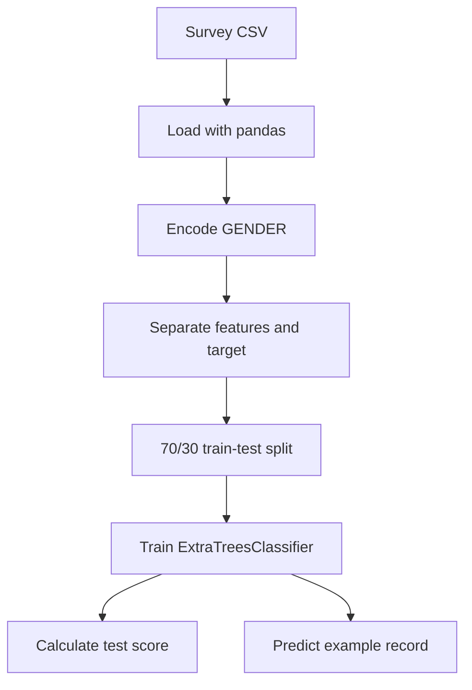

<div align="center">

# Lung Cancer Survey Classification

**An educational supervised-learning experiment using a public survey dataset.**


</div>

> [!WARNING]
> **Not for medical use.** This project is a learning experiment, not a medical device or diagnostic system. Its output must not be used for screening, diagnosis, treatment, or healthcare decisions.

## Contents

- [Project overview](#project-overview)
- [How it works](#how-it-works)
- [Dataset](#dataset)
- [Quick start](#quick-start)
- [Repository structure](#repository-structure)
- [Evaluation and limitations](#evaluation-and-limitations)
- [Reproducibility](#reproducibility)
- [License](#license)

## Project overview

This repository demonstrates a compact classification workflow with Python, pandas, and scikit-learn. It loads a lung-cancer survey dataset, converts the gender field to a numeric representation, separates features from the target, trains an `ExtraTreesClassifier`, and evaluates an example patient record.

The goal is to practice a complete machine-learning flow — from tabular data to model inference — while understanding the limitations of small public datasets.

## How it works



The current script uses a 30% test split and calls the classifier's `score()` method. The score is not currently printed or saved as a report.

## Dataset

The repository includes [survey_lung_cancer.csv](survey_lung_cancer.csv). The script's original comment attributes the dataset to the [Kaggle Lung Cancer Detection dataset](https://www.kaggle.com/datasets/jillanisofttech/lung-cancer-detection).

Review the dataset's provenance, field definitions, and terms before using it in another context.

## Quick start

### Requirements

- Python 3
- pip

### Install

```bash
git clone https://github.com/Edumarek123/ML_LUNG_CANCER.git
cd ML_LUNG_CANCER
python3 -m pip install pandas scikit-learn
```

### Run

```bash
python3 lung_cancer.py
```

Run the script from the repository root so the relative CSV path resolves correctly.

## Repository structure

```text
ML_LUNG_CANCER/
├── lung_cancer.py
├── survey_lung_cancer.csv
└── README.md
```

## Evaluation and limitations

This repository should be treated as an introductory experiment, not a clinically meaningful model. The current implementation does not establish external validity, calibration, fairness, clinical utility, or generalization to a real patient population.

For a stronger experiment, consider documenting class balance, preprocessing decisions, a fixed random seed, confusion matrix, precision, recall, F1-score, and validation on an independent dataset.

## Reproducibility

The current train/test split and model are created without an explicit random seed. Results may therefore vary between runs. Record the dataset version and experiment settings when comparing results.

## License

No `LICENSE` file is currently included. Unless a license is added, reuse and redistribution permissions are not granted by this repository.
